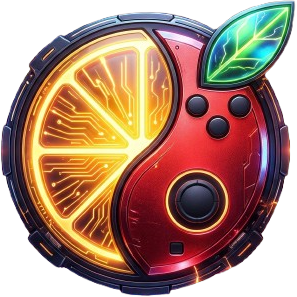

<!--
SPDX-FileCopyrightText: Copyright 2026 Lemon-Project
SPDX-License-Identifier: GPL-3.0-or-later

SPDX-FileCopyrightText: 2018 yuzu Emulator Project
SPDX-License-Identifier: GPL-2.0-or-later
-->

<h1 align="center">
   
  
   
  <b>Iron Lemon</b>
   
</h1>

<h4 align="center">An Android-only Nintendo Switch emulator: the original yuzu experience, with Lemon's improvements.</h4>

<h1 align="center">⛔ NOT A FORK OF EDEN ⛔</h1>

<b>
Iron Lemon is built directly on the original <a href="#origin">yuzu mainline-0-1734</a> (March 2024). 
It contains no Eden history, no Eden commits and none of Eden's changes.
</b>

## Origin

- **Base:** original yuzu mainline-0-1734, Android app included, kept as the yuzu team left it.
  The git history of this repository is the yuzu history up to that point.
- **On top:** only the work of the Lemon team (performance, drivers, Adreno fixes, NCE, GPU),
  re-applied commit by commit on top of yuzu.
- **Excluded on purpose:** every commit authored by Eden developers, and Eden's Android UI changes.
- **Android only:** the desktop frontends are removed.

Made by **Team Lemon**: Ghael, Seak, Sidgey, BitRanger and rcssf.

## License

yuzu code is GPL-2.0-or-later, Lemon additions are GPL-3.0-or-later. Original copyright notices
are preserved. See `LICENSE.txt` and `LICENSES/`.
